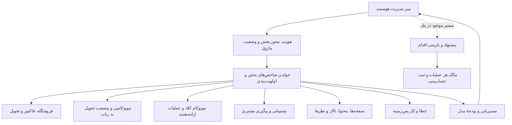

# نقشهٔ توسعهٔ موبوکام برای مدیریت هوشمند

مبنای این نقشه `main` در کامیت `d55452a8` و توسعهٔ میز مدیریت روی همان مبناست.
استخراج آفلاین Graphify 0.9.84 از ۳٬۳۳۵ فایل کد، ۲۱٬۳۳۷ گره و ۸۵٬۱۳۶
رابطه به دست داد. خروجی کامل در
`.mobocom/graphify/graphify-out/graph.json` داخل همین checkout است.
عددها حجم نقشهٔ کد را نشان می‌دهند. آمادگی محیط عملیاتی با گواه جداگانه تعیین می‌شود.

| بخش | وضعیت بر پایهٔ کد و handoff | پوشش میز جدید | کار بعدی |
| --- | --- | --- | --- |
| هستهٔ هوش مصنوعی | مسیریابی کاربرد، اتصال شخصی مدیر، بودجه، پایش، پیش‌نویس و اجرای محدود با ثبت نتیجه | تحلیل اختیاری، بررسی دوره‌ای، تاریخچه و ثبت نتیجهٔ پیگیری با مجوز فعلی | ارزیابی کیفیت پیشنهاد با سناریوهای واقعی و افزودن فرمان بررسی‌شده برای عملیات هر بخش |
| فروشگاه | سفارش، فاکتور، کیف پول، تحویل، مرجوعی و مدیریت موجودی در مالکان فعلی | تحویل در انتظار برای سفارش آنلاین پرداخت‌شده | تحلیل علت توقف از وضعیت موجودی/ارسال و پیشنهاد اقدام از مسیر عملیات سفارش |
| موبوکام‌پی | فاکتور میزبانی‌شده، تطبیق پیامک، اعتبار، تحویل به ربات و وب‌هوک | پرداخت قطعی با تحویل متوقف یا نامشخص به ربات | اتصال وضعیت منبع SMS و ظرفیت مبلغ یکتا به گزارش، سناریوی عملیاتی با گوشی و بانک |
| موبوکام کلاد | فضای مشتری، فاکتور، بلیت و فرمان‌های نسخه‌دار ارائه‌دهنده | گزارش عملیات با نتیجهٔ نامشخص | پیوند وضعیت تمدید، ظرفیت و سلامت اتصال به گزارش مدیر، پذیرش هر ارائه‌دهنده در مقصد |
| مدیریت ارتباط با مشتریان | فرصت، پیگیری، پیش‌فاکتور و دسترسی مسئول | پیگیری‌های معوق در محدودهٔ مجاز | پیشنهاد کار بعدی برای فرصت و پیش‌فاکتور و نتیجهٔ قابل پیگیری |
| پشتیبانی | دپارتمان، مالکیت تیکت و شاخص‌های گردش کار | تیکت باز بدون به‌روزرسانی در دپارتمان مجاز | تحلیل SLA از منبع موجود و آماده‌سازی پیش‌نویس پاسخ برای مسئول |
| صفحه‌ها و مجله | ویرایشگر، بازبینی، انتشار و تاریخچه | پیش‌نویس صفحه‌ها و صف بازبینی مجله | برنامهٔ انتشار با شواهد، بررسی تغییر پیشنهادی، پوشش سئو و رسانه |
| موزیک، فیلم/سریال، بازی، نرم‌افزار | مدیریت عنوان‌ها، taxonomy و اختیار مدیر بخش | یک صف بازبینی برای هر بخش | افزودن پوشش آلبوم/قسمت/نسخه، بررسی کامل بودن رسانه و داده از مالک همان حوزه |
| تالار و نظرها | گزارش کاربر و بازبینی محتوا با مجوزهای جداگانه | صف گزارش تالار و بازبینی نظرهای عمومی | پیشنهاد بازبینی موردی با شواهد مجاز و ثبت تصمیم انسانی |
| جست‌وجو، رسانه و کسب‌وکار | قابلیت‌های مستقل برای ایندکس و مدیریت رسانه و تجربهٔ کسب‌وکار | در این نما شاخص مستقلی ندارند | پوشش سلامت ایندکس، دارایی‌های معیوب و صف بررسی کسب‌وکار به‌تفکیک |
| عملیات و زیرساخت | صف پایدار، داشبورد خطا، سلامت، بکاپ و بازیابی | تعداد کارهای ناموفق ۲۴ ساعت اخیر | گزارش ماندگار روند و هشدارهای مبتنی بر شاخص‌های عملیاتی |

## مسیرهای تأییدشده در Graphify

- `collectManagement` به گاردهای هویت، وضعیت افزونه، API مدیریت و خواندن بخش‌ها وصل است. مسیر اقدام موجود از `operationsContext` و سرویس پیشنهاد می‌گذرد.
- `createPayPayment`، `startPayGateway`، `matchBaleNotice` و `markInvoicePaid` جریان‌های پرداخت، فاکتور و تطبیق را در Billing و Checkout نشان می‌دهند.
- `listFollowUpQueue`، `runCloudOperation` و `enqueueOrderFulfillment` مالکان پیگیری مشتری، عملیات کلاد و تحویل رویدادمحور را نشان می‌دهند.

جست‌وجوها با بودجهٔ محلی ۱۵۰۰ توکن اجرا شدند و هر کدام نقطه‌های شروع و
مسیرهای مالک را برگرداندند. شواهد اجرای محصول در
[تحویل میز مدیریت](handoffs/AI_MANAGEMENT.md) و جزئیات هر حوزه در
[نقشهٔ مالکیت](MOBOCOM_MAP.md) و [ثبت قابلیت‌ها](CAPABILITY_LEDGER.md) آمده است.
